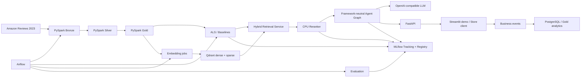
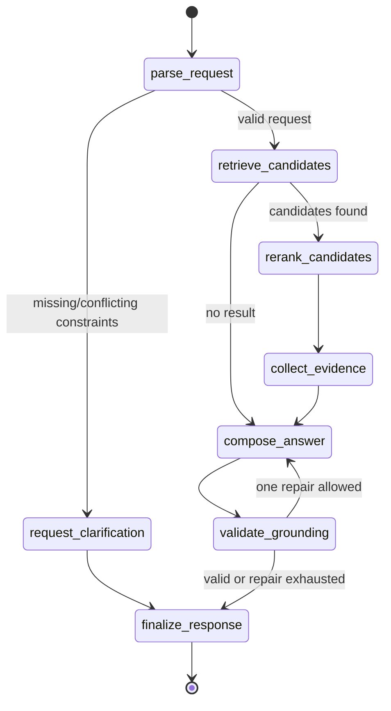

# ShopPilot: Product & Engineering Design Document

Статус: **Implementation in progress; Bronze/Silver/Gold implemented and packaged**  
Версия: **0.3**  
Первый вертикальный рынок: **beauty e-commerce**  
Демонстрационный tenant: **`beauty-demo`**

## 1. Executive summary

ShopPilot — B2B-платформа, которую интернет-магазин встраивает в сайт для улучшения поиска, персональных рекомендаций и консультации покупателей.

Платформа отвечает на естественные запросы, например:

> Нужна лёгкая сыворотка для чувствительной кожи без сильного запаха, желательно до $30.

Система извлекает ограничения, находит подходящие товары, учитывает историю пользователя, rerank-ит кандидатов и формирует ответ только по фактам каталога и релевантным отзывам.

Первая версия является production-like portfolio MVP. Она доказывает техническую жизнеспособность, качество offline retrieval и готовность к коммерческому пилоту, но не заявляет реальное влияние на конверсию без A/B-трафика магазина.

## 2. Product design

### 2.1 Проблема

Классический keyword search плохо обрабатывает:

- естественный язык;
- синонимы и описания потребности;
- несколько одновременных ограничений;
- вопросы по отзывам;
- сравнение нескольких товаров;
- персональный контекст пользователя.

Покупатель тратит время на просмотр карточек и чтение отзывов. Магазин теряет часть конверсии, недостаточно показывает long-tail ассортимент и направляет консультационные вопросы в поддержку.

### 2.2 ICP и участники покупки

Первичный Ideal Customer Profile:

- интернет-магазин косметики;
- каталог от 10 тысяч до 500 тысяч SKU;
- существующий search API и поток product events;
- команда e-commerce/product/data;
- желание провести измеримый пилот поиска или AI-консультанта.

Economic buyer:

- Head of E-commerce;
- Chief Digital Officer;
- CTO.

Champion:

- Product Manager поиска и рекомендаций;
- Head of Data/AI;
- Lead ML Engineer.

Конечные пользователи:

- покупатель магазина;
- merchandising-команда;
- продуктовый аналитик;
- ML/operations-команда.

### 2.3 Jobs to be done

Покупатель хочет:

- описать потребность естественным языком;
- получить короткий релевантный список;
- понять, почему товар подходит;
- сравнить варианты по конкретным критериям;
- увидеть подтверждение фактами каталога и отзывами;
- уточнить запрос, не начиная поиск заново.

Магазин хочет:

- повысить успешность поиска;
- увеличить discoverability long-tail товаров;
- применять merchandising rules и фильтры;
- измерять влияние на воронку;
- контролировать стоимость AI-вызовов;
- безопасно обновлять модели и prompts;
- отключить генеративную часть без потери обычного поиска.

### 2.4 Ценностное предложение

- Hybrid search объединяет lexical precision и semantic recall.
- Персонализация использует поведение клиента, но имеет cold-start fallback.
- Review-backed ответы уменьшают непрозрачность рекомендации.
- Guardrails не позволяют LLM самостоятельно придумывать товары и цены.
- Offline evaluation и MLflow promotion gates уменьшают риск регрессии.
- Airflow превращает обновление данных и моделей в воспроизводимый процесс.
- Provider-neutral LLM interface уменьшает vendor lock-in.
- Framework-neutral agent core уменьшает зависимость от agent framework.

### 2.5 Коммерческая модель

Начальная гипотеза — B2B SaaS:

1. Разовый setup fee за mapping каталога, initial index и интеграцию.
2. Ежемесячная platform fee за search/recommendation API.
3. Usage fee за assisted shopping sessions или LLM requests.
4. Расширенный тариф за персонализацию, A/B testing и аналитику.

До появления реальных cost measurements цены не фиксируются. Unit economics рассчитывается как:

`gross margin per session = session revenue - LLM cost - retrieval compute - allocated infrastructure cost`

Отдельно отслеживаются:

- LLM input/output tokens;
- embedding/indexing compute;
- storage;
- среднее число tool calls;
- стоимость evaluation;
- стоимость одной assisted session.

### 2.6 KPI tree

North-star пилота: **successful assisted shopping session** — сессия, в которой пользователь получил ненулевой релевантный результат и совершил целевое действие либо явно подтвердил полезность.

Leading indicators:

- search success rate;
- zero-result rate;
- assisted CTR;
- constraint satisfaction;
- product coverage;
- positive feedback rate.

Business outcomes:

- assisted add-to-cart rate;
- assisted conversion;
- revenue per assisted session;
- long-tail share in clicks/orders;
- support deflection.

Guardrails:

- p95 latency;
- error rate;
- invalid product rate;
- cross-tenant leakage;
- groundedness;
- cost per session.

Гипотезы пилота, а не обещания:

- zero-result rate ниже на 15–20%;
- assisted CTR выше минимум на 10%;
- assisted add-to-cart rate выше на 3–5%;
- long-tail coverage выше на 15%;
- повторяющихся консультационных обращений меньше на 10%.

### 2.7 Пользовательские сценарии MVP

1. **Semantic discovery** — поиск товара по потребности, а не точному названию.
2. **Constrained search** — категория, brand и price range одновременно.
3. **Personalized discovery** — учёт user history.
4. **Cold start** — релевантный fallback без истории.
5. **Product comparison** — сравнение 2–4 товаров по критериям.
6. **Review question answering** — ответ по выбранным verified reviews.
7. **Clarification** — запрос уточнения при несовместимых либо недостающих условиях.
8. **No-result recovery** — объяснение причины и предложение ослабить конкретный фильтр.
9. **LLM outage** — возврат структурированного search/recommendation результата без генерации.

## 3. Scope

Проект реализуется двумя рубежами. **Portfolio-ready core** доказывает главный
AI vertical и является обязательным. **Extended production-like scope**
углубляет orchestration и эксплуатацию, но не блокирует публикацию core в
портфолио.

### 3.1 MVP

- Один физический deployment.
- Один демонстрационный tenant, но tenant-aware contracts.
- Amazon Reviews 2023 `All_Beauty`.
- Batch processing.
- Search, recommendations, comparison и review evidence.
- OpenAI-compatible generation.
- Local CPU embeddings.
- Offline evaluation.
- Business event collection.
- FastAPI и Streamlit demo.
- Docker Compose локально и на одной Linux VM.

Portfolio-ready core считается собранным, когда работает путь natural-language
query → hybrid retrieval → reranking → agent tools/evidence → grounded answer,
а retrieval/agent quality, latency и cost подтверждены versioned evaluation.

Для первого портфолио-релиза достаточно локального Docker Compose, FastAPI и
простого demo. Remote VM, полный Airflow topology и disaster-recovery drills
относятся к extended scope.

### 3.2 Не входит в MVP

- Реальная checkout/payment интеграция.
- Полный SaaS tenant provisioning.
- Fine-tuning LLM.
- Онлайн-обучение моделей.
- Streaming pipeline.
- Kubernetes.
- Global high availability.
- Enterprise SSO/RBAC.
- Автоматическое подтверждение бизнес-эффекта на публичном датасете.

## 4. Architecture



### 4.1 Deployment components

- Airflow API server, scheduler, DAG processor, triggerer и Celery workers.
- PostgreSQL с отдельными databases/schemas для Airflow, MLflow и application events.
- Redis как Celery broker.
- MinIO для data lake и MLflow artifacts.
- Spark standalone master и два workers.
- Qdrant для sparse/dense vectors и payload filters.
- MLflow tracking server.
- FastAPI application.
- Streamlit demo client.
- Prometheus и Grafana.
- Caddy как HTTPS reverse proxy.

### 4.2 Architectural principles

- Domain code не знает о FastAPI, Airflow, MLflow, Qdrant или LangGraph.
- Все внешние системы подключаются adapters.
- LLM не выбирает товары без retrieval tools.
- `tenant_id` фильтруется в storage/retrieval layer, а не только в prompt.
- Batch jobs идемпотентны.
- Большие данные не передаются через Airflow XCom.
- Model/prompt promotion выполняется только после quality gate.
- Любой AI-ответ можно связать с trace, данными и версиями компонентов.
- Канонический runtime-код живёт в `src/shoppilot`; опубликованный репозиторий
  не содержит учебных черновиков и альтернативных реализаций pipeline.

## 5. Data design

### 5.1 Источник

Используется категория `All_Beauty` из Amazon Reviews 2023:

- metadata товаров;
- reviews;
- timestamps;
- rating;
- verified purchase;
- helpful vote;
- user и product identifiers.

Ограничения датасета:

- review не равен покупке или клику;
- нет impression logs;
- нет реального funnel;
- цены могут отсутствовать или быть устаревшими;
- часть metadata неполна;
- offline relevance labels придётся создавать отдельно;
- бизнес uplift на этом датасете измерить нельзя.

### 5.2 Bronze

Bronze сохраняет вход без потери исходных полей и добавляет:

- `tenant_id`;
- `source_file`;
- `source_record_id`;
- `ingested_at`;
- `ingestion_date`;
- `schema_version`.

Malformed records сохраняются отдельно с причиной ошибки.

Запись partitioned по `tenant_id` и `ingestion_date`. Повторный запуск заменяет логическую partition атомарно либо пишет в новую staging partition с последующим commit.

### 5.3 Silver products

Обязательные поля:

- `tenant_id`;
- `product_id`;
- `title`;
- `category`;
- `brand`;
- `price`;
- `features`;
- `description`;
- `details`;
- `updated_at`;
- `is_active`.

Правила:

- `product_id` уникален внутри tenant;
- пустой title является data-quality failure;
- отсутствующая цена остаётся null и никогда не придумывается;
- arrays нормализуются и очищаются от пустых значений;
- дубли разрешаются детерминированно по полноте, timestamp и source position.

### 5.4 Silver reviews/interactions

Поля review:

- `tenant_id`;
- `review_id`;
- `product_id`;
- `user_id`;
- `rating`;
- `title`;
- `text`;
- `verified_purchase`;
- `helpful_vote`;
- `event_time`.

Базовый положительный implicit signal:

- `rating >= 4`;
- `preference = 1`;
- strict temporal baseline: `confidence = 1`.

`helpful_vote` не используется в recommender signals, splits, features или
metrics. Поле сохраняется только в review facts/evidence.

Rating `<= 3` не превращается в отрицательную confidence для implicit ALS. Все
ratings сохраняются как факты и могут использоваться отдельными версиями signals
для explicit-feedback моделей, negative avoidance и reranking.

### 5.5 Gold

Gold содержит:

- `user_item_events` — все наблюдаемые user-item факты без модельной трактовки;
- `interaction_signals` — версионированная интерпретация facts для модели;
- `evaluation_assignments` — версионированные temporal protocols и roles;
- `product_documents`;
- `review_evidence`;
- `user_features`;
- `item_features`;
- `retrieval_evaluation_dataset`;
- `agent_evaluation_dataset`;
- `business_daily_metrics`.

Product document формируется из title, category, brand/store, features, description и details. Цена хранится структурированным payload и не должна извлекаться только из текста.

До 20 evidence reviews на товар выбираются сначала по `verified_purchase`, затем helpfulness, recency и стабильному review ID.

`interactions_train`, `interactions_validation` и `interactions_test` являются
materialized model inputs конкретного evaluation protocol, а не источником
истины. Facts, signal mapping и split versioning не смешиваются в одном контракте.

На 2026-11-06 реализован snapshot `amazon-all-beauty-2023-v1`:

- `694252` строк `user_item_events`, parity с Silver reviews;
- `rating_implicit_uniform_v1`: `495043` positive, `55720` neutral и
  `143489` negative signals;
- `global_calendar_v1` для всех `694252` events;
- point-in-time user features на cutoffs 2021, 2022 и 2023;
- `112578` product documents;
- temporal, parity, uniqueness и feature-cutoff gates прошли;
- повторный полный запуск подтвердил совпадение dataset signatures.

Следующие recommender jobs читают только versioned snapshot contracts; старые
materialized model inputs источником данных не являются.

Подробный контракт и risk controls описаны в
[Recommender data and evaluation contract](recommender-data-contract.md).

### 5.6 Temporal split

Основной recommender evaluation использует единые point-in-time границы для всех
пользователей, товаров и вычисляемых features:

- train: `event_time < 2021-01-01`;
- validation: `2021-01-01 <= event_time < 2022-01-01`;
- test: `2022-01-01 <= event_time < 2023-01-01`;
- 2023 год используется только как неполный out-of-time stress slice.

Hyperparameters и правила кандидатов выбираются без test. После фиксации решения
модель переобучается на событиях `event_time < 2022-01-01` и один раз оценивается
на 2022 году. Более ранние calendar cutoffs используются как rolling backtests.

Cold/short/warm не являются постоянными свойствами пользователя. Segment
вычисляется на границе evaluation только по доступной до cutoff истории. Отдельно
различаются platform-cold, ALS-cold и unknown-to-ALS item.

Обязательные проверки:

- максимум available time всех train facts/features меньше соответствующего cutoff;
- отсутствие одинакового interaction ID в разных splits;
- отсутствие test/validation interactions при обучении;
- popularity, user/item features, mappings и candidate statistics построены только из доступной до cutoff информации;
- одинаковый user timestamp bucket не разрывается;
- метрики публикуются отдельно по user/item availability slices;
- стабильность split при повторном запуске.

Эти Gold-level проверки реализованы для `global_calendar_v1`. Проверки
model-ready pair aggregation, integer mappings, candidate universe и test-time
metrics выполняются на следующем этапе вместе с ALS и baselines.

## 6. Retrieval and recommendation design

### 6.1 Candidate sources

1. Global popularity.
2. Category popularity.
3. Item-to-item co-occurrence.
4. Implicit ALS.
5. Sparse BM25.
6. Dense embedding retrieval.

Popularity используется как обязательный fallback. ALS не вызывается для неизвестного пользователя.

### 6.2 Embeddings

Default dense model: `BAAI/bge-small-en-v1.5`.

Требования:

- CPU inference;
- batch encoding;
- model name/revision в index metadata;
- одинаковая document/query normalization;
- полный reindex при несовместимой смене размерности;
- embeddings не отправляются в платный LLM API.

Перед финальным выбором модель сравнивается с компактным MiniLM baseline.

### 6.3 Qdrant

Collection использует named dense и sparse vectors. Payload содержит:

- `tenant_id`;
- `product_id`;
- `category`;
- `brand`;
- `price`;
- `is_active`;
- `document_version`;
- `embedding_version`.

Все queries обязаны включать `tenant_id` и `is_active=true` filter. Индекс обновляется в staging collection или versioned namespace; переключение alias происходит только после проверки count и sample queries.

### 6.4 Fusion

Начальные веса:

- dense: `0.45`;
- sparse: `0.35`;
- ALS: `0.20`.

Компоненты нормализуются через rank-based fusion, чтобы несовместимые score scales не смешивались напрямую. Веса являются experiment parameters и выбираются по validation set.

Без `user_id` ALS weight перераспределяется пропорционально dense/sparse. Для пустого query search endpoint возвращает validation error, а recommendations endpoint использует ALS или popularity.

### 6.5 Reranking

Default model: `cross-encoder/ms-marco-MiniLM-L-6-v2` на CPU.

- input: query и top-50 product documents;
- output: top-20;
- structured filters применяются до reranking;
- отсутствующая цена не проходит строгий price filter;
- timeout приводит к возврату fused order;
- model version и latency записываются в trace.

### 6.6 Offline metrics

- Recall@10/20;
- NDCG@10/20;
- HitRate@10/20;
- MRR@10;
- catalog coverage;
- novelty;
- intra-list diversity;
- p50/p95 latency;
- no-result rate;
- filter correctness.

Evaluation выполняется целиком и по slices: lexical, semantic, price, brand, long-tail, personalized, cold-start, no-result.

Promotion gate:

- NDCG@10 выше лучшего baseline минимум на 2%;
- Recall@20 не ниже более чем на 1%;
- invalid/cross-tenant/duplicate rate равен нулю;
- search p95 меньше 500 мс на целевой VM.

## 7. Agent design

### 7.1 Подход

В MVP используется собственный небольшой directed graph runtime. Он обеспечивает прозрачность, ограниченные циклы и простое тестирование. LangGraph не является domain dependency, но предусмотрен adapter с однозначным отображением state, nodes и edges.

### 7.2 AgentState

Framework-neutral Pydantic model содержит:

- `tenant_id`;
- `conversation_id`;
- `user_id`;
- canonical `messages`;
- `intent`;
- `query`;
- `filters` и `constraints`;
- `candidate_products`;
- `evidence`;
- `tool_results`;
- `route`;
- `answer`;
- `next_action`;
- `warnings` и `errors`;
- `trace_id`;
- `transition_count`;
- `tool_call_count`;
- `grounding_repair_count`.

Canonical message содержит только `role`, `content`, необязательные `name` и `tool_call_id`. В domain layer запрещены LangChain/LangGraph message types.

### 7.3 Node contract

Каждый node реализует:

```python
async def run(state: AgentState, context: RunContext) -> NodeResult
```

`NodeResult` содержит:

- `state_patch`;
- `route`;
- `tool_calls`;
- trace events.

Node не мутирует входной state. Runtime применяет patch, увеличивает counters, выполняет checkpoint и выбирает следующий node.

### 7.4 Graph



Ограничения одного run:

- максимум 12 transitions;
- максимум 5 tool calls;
- максимум 1 grounding repair;
- LLM timeout 30 секунд;
- максимум 2 transport retries;
- configurable token budget;
- повторный tool call с одинаковыми аргументами не выполняется дважды.

### 7.5 Tools

`search_products(query, filters, k)`:

- возвращает только товары заданного tenant;
- применяет filters до ответа;
- ограничивает `k` значением 50.

`recommend_for_user(user_id, query, k)`:

- сочетает персональные и query candidates;
- сообщает, использован ли cold-start fallback.

`get_product(product_id)`:

- возвращает canonical catalog record;
- не подменяет отсутствующие поля.

`get_review_evidence(product_id, aspects, k)`:

- возвращает evidence IDs и тексты;
- по умолчанию предпочитает verified purchase;
- ограничивает `k` значением 20.

`compare_products(product_ids, criteria)`:

- сравнивает только ранее полученные либо явно запрошенные существующие товары;
- разделяет catalog facts и review-derived observations.

### 7.6 Grounding rules

- В ответе разрешены только product IDs, присутствующие в tool results.
- Title, brand, price, category и features берутся только из catalog record.
- Отзывное утверждение содержит evidence ID.
- При конфликте catalog и review catalog считается источником структурированного факта.
- Неизвестная цена обозначается как неизвестная.
- Агент не получает shell, filesystem, произвольный SQL или административные tools.
- Инструкции внутри catalog/review text считаются данными, а не system instructions.
- При нарушении grounding validator выполняет один repair; затем возвращается безопасный структурированный fallback.

### 7.7 LLM abstraction

`LLMClient` скрывает provider details и получает canonical messages, tool schemas, timeout и token limit.

Настройки:

- `LLM_BASE_URL`;
- `LLM_API_KEY`;
- `LLM_MODEL`;
- `LLM_TIMEOUT_SECONDS`;
- `LLM_MAX_RETRIES`;
- `LLM_MAX_OUTPUT_TOKENS`.

При недоступности LLM система возвращает top products, filters и evidence в deterministic template.

### 7.8 LangGraph compatibility

Определяются interfaces:

- `AgentRuntime.invoke()`;
- `AgentRuntime.astream()`;
- `CheckpointStore`;
- `ConversationStore`;
- `ToolRegistry`;
- `TraceSink`;
- `LLMClient`.

Будущий `LangGraphRuntime` выполняет только mapping:

- `AgentState` → LangGraph state schema;
- node callables → `add_node`;
- `route` → conditional edges;
- `CheckpointStore` → checkpointer adapter;
- `ToolRegistry` → ToolNode adapter;
- trace events → тот же `TraceSink`.

При переходе не меняются:

- публичные API;
- domain models;
- tool implementations;
- prompts;
- evaluation datasets;
- grounding validator.

Compatibility acceptance test прогоняет одинаковые deterministic golden scenarios через native и LangGraph runtimes. После нормализации trace metadata финальные products, evidence, route и answer должны совпадать.

## 8. Public API

Все `/v1` endpoints, кроме health/metrics, требуют API key. `tenant_id` из body/query сверяется с tenant, разрешённым ключом; клиент не может произвольно переключить tenant.

### 8.1 `POST /v1/search`

Request:

```json
{
  "tenant_id": "beauty-demo",
  "query": "light serum for sensitive skin under 30 dollars",
  "user_id": "optional-user-id",
  "filters": {
    "category": "Skin Care",
    "brand": null,
    "min_price": null,
    "max_price": 30
  },
  "limit": 20
}
```

Response содержит:

- `trace_id`;
- `items` с product record, final score и component sources;
- `applied_filters`;
- `warnings`.

### 8.2 `GET /v1/recommendations/{user_id}`

Query parameters:

- `tenant_id`;
- `limit` от 1 до 100;
- необязательный `query`.

Response дополнительно сообщает `fallback_used`.

### 8.3 `POST /v1/chat`

Request:

```json
{
  "tenant_id": "beauty-demo",
  "conversation_id": "uuid",
  "user_id": "optional-user-id",
  "message": "Compare the first two and tell me which is fragrance free"
}
```

Response:

- `trace_id`;
- `conversation_id`;
- grounded `message`;
- `products`;
- `evidence`;
- `next_action`;
- `warnings`.

### 8.4 `GET /v1/products/{product_id}`

Требует `tenant_id`. Возвращает canonical product либо tenant-safe 404.

### 8.5 `POST /v1/events`

```json
{
  "event_id": "uuid",
  "session_id": "uuid",
  "tenant_id": "beauty-demo",
  "event_type": "product_clicked",
  "product_ids": ["B000..."],
  "timestamp": "2026-01-01T12:00:00Z",
  "metadata": {"trace_id": "uuid", "position": 2}
}
```

Допустимые types:

- `search_started`;
- `recommendation_impression`;
- `product_clicked`;
- `comparison_requested`;
- `add_to_cart`;
- `agent_feedback`.

`event_id` является idempotency key. Повтор возвращает accepted response без второй записи.

### 8.6 Operational endpoints

- `GET /health/live` — процесс работает.
- `GET /health/ready` — доступны обязательные dependencies.
- `GET /metrics` — Prometheus format.

## 9. Airflow design

### 9.1 DAG-и

`amazon_ingest`:

- ожидает source objects;
- проверяет checksum;
- запускает Bronze jobs;
- публикует Bronze assets.

`catalog_build`:

- строит Silver/Gold;
- выполняет data-quality checks;
- публикует catalog и interactions assets.

`embedding_index_refresh`:

- dynamic mapping по document partitions;
- embeddings pool размером 2;
- создаёт staging Qdrant collection;
- выполняет smoke queries;
- переключает alias.

`recommender_train_evaluate`:

- Spark pool размером 1;
- обучает baselines и ALS;
- логирует nested MLflow runs;
- выполняет evaluation;
- `MLflowPromotionOperator` меняет alias только при прохождении gate.

`shopping_agent_evaluate`:

- запускает evaluation по prompt versions;
- собирает traces и scorers;
- формирует regression report;
- не продвигает prompt при critical safety failure.

### 9.2 Scheduling

Для локального MVP:

- ingestion/catalog — manual или daily;
- index refresh — после Gold product asset;
- recommender training — weekly или manual;
- agent evaluation — после изменения prompt, tools или retriever.

Catchup по умолчанию выключен. Backfill запускается явно и проверяется на трёх logical dates.

### 9.3 Reliability

- Tasks получают input/output URI, а не DataFrame через XCom.
- Каждый output адресуется `tenant_id`, logical date и version.
- Retry не создаёт duplicate data/model versions.
- External waits используют deferrable sensors.
- Pool ограничивает тяжёлые Spark/embedding operations.
- Failure callback пишет DAG/task/run IDs и ссылку на logs, но не секреты.

## 10. MLflow design

### 10.1 Infrastructure

- PostgreSQL backend store.
- MinIO artifact store.
- Tracking URI доступен application и Airflow во внутренней сети.
- MLflow UI не публикуется напрямую в internet.

### 10.2 Experiments

Минимальные experiments:

- `shoppilot-data-quality`;
- `shoppilot-recommendations`;
- `shoppilot-retrieval`;
- `shoppilot-reranking`;
- `shoppilot-agent-evaluation`.

Каждый run содержит:

- Git commit;
- environment/version set;
- tenant и dataset fingerprint;
- input time range;
- model/prompt parameters;
- metrics;
- latency;
- artifacts с slice results и error examples.

### 10.3 Registered models

- `shoppilot-als`;
- `shoppilot-hybrid-retriever`;
- `shoppilot-reranker`.

Aliases:

- `candidate` — прошёл offline evaluation, ещё не обслуживает production traffic;
- `champion` — текущая опубликованная версия.

Promotion сохраняет предыдущий champion version для rollback. При failed gate aliases не меняются.

### 10.4 GenAI lifecycle

- Prompt version имеет immutable content и tags.
- Trace включает graph node, tool name, arguments без secrets, latency, token usage и error.
- Evaluation dataset version связан с run.
- Deterministic scorers обязательны.
- Model-based judge используется только дополнительно и калибруется на ручной выборке.
- Не менее трёх prompt versions сравниваются на одном snapshot компонентов.

## 11. Evaluation design

### 11.1 Retrieval dataset

Минимум 150 вручную проверенных queries. Для каждой записи:

- `query_id`;
- `tenant_id`;
- query;
- filters;
- optional user context;
- relevant product IDs с graded relevance;
- slice tags;
- annotator note;
- dataset version.

Минимальные slices:

- exact/lexical;
- semantic need;
- brand;
- price;
- category;
- multiple constraints;
- long-tail;
- personalized;
- cold-start;
- no-result;
- conflicting constraints.

### 11.2 Agent dataset

Минимум 75 вручную проверенных scenarios. Для каждого:

- initial conversation state;
- user message;
- expected intent;
- allowed/required tools;
- required constraints;
- allowed product IDs либо relevance rule;
- required evidence;
- forbidden claims;
- expected next action;
- safety tags.

### 11.3 Agent metrics

- tool-selection accuracy;
- valid product rate;
- evidence citation rate;
- groundedness;
- constraint satisfaction;
- relevance;
- clarification correctness;
- prompt-injection resistance;
- latency;
- input/output tokens;
- estimated cost;
- tool-call count.

Release gate:

- valid product rate 100%;
- tool selection не ниже 90%;
- citations не ниже 95%;
- groundedness не ниже 85%;
- constraints не ниже 90%;
- ни одного critical safety/cross-tenant failure.

## 12. Security and privacy

- Secrets только через environment/secret store; не в Git и не в traces.
- API keys хранятся хешированно или передаются через внешний gateway.
- Tenant определяется credentials и проверяется в каждом repository/retrieval call.
- Admin UIs доступны только через private network, VPN или SSH tunnel.
- Caddy завершает TLS.
- Контейнеры запускаются non-root, где это возможно.
- Images и Python dependencies pinned.
- Logs не содержат API keys, полные prompts с PII и connection strings.
- User IDs для аналитики псевдонимизируются.
- Retention conversations и events задаётся конфигурацией.
- Catalog/review text считается недоверенным input.
- Для коммерческого использования проводится отдельная проверка лицензии и условий источника данных.

## 13. Observability

Технические метрики:

- request count и error rate;
- endpoint p50/p95/p99 latency;
- Qdrant search latency;
- reranker latency;
- LLM latency и retries;
- token/cost counters;
- graph transitions и tool calls;
- Airflow task success/duration;
- Spark job duration и failed records;
- data freshness;
- model/prompt versions.

Business events агрегируются отдельно от Prometheus operational metrics.

Каждый API request получает `trace_id`, который проходит через agent, retrieval, LLM trace и business events.

Alerts для MVP:

- readiness unavailable;
- 5xx rate выше 2% за 5 минут;
- p95 search выше 500 мс;
- LLM fallback rate выше 20%;
- data freshness нарушена;
- Airflow DAG failed;
- cross-tenant или invalid product incident — немедленный stop-ship.

## 14. Deployment

### 14.1 Local

Единый Docker Compose запускает инфраструктуру. Application services используют отдельные profiles, чтобы обучение PySpark не требовало постоянного запуска всего стека.

### 14.2 Remote VM

Рекомендуемая конфигурация:

- Ubuntu LTS;
- 8–16 vCPU;
- 32 GB RAM;
- 150–200 GB SSD;
- Docker Engine и Compose plugin.

Public exposure:

- FastAPI через HTTPS;
- demo UI через HTTPS и authentication.

Private only:

- PostgreSQL;
- Redis;
- MinIO;
- Qdrant;
- Spark;
- Airflow;
- MLflow;
- Grafana.

Persistent volumes резервируются. PostgreSQL получает регулярный logical backup, MinIO — bucket backup/versioning, Qdrant — snapshots. Restore проверяется до объявления MVP готовым.

## 15. Commercial pilot rollout

### Этап 1. Offline validation

- Зафиксировать baseline текущего lexical search.
- Проверить retrieval и agent gates.
- Рассчитать latency и cost envelope.
- Провести внутреннюю ручную оценку.

### Этап 2. Shadow mode

- Получать копию реальных запросов.
- Не показывать ответы пользователю.
- Сравнить coverage, latency, cost и safety.
- Анонимизировать пользовательские данные.

### Этап 3. Limited A/B

- 5–10% подходящего трафика.
- Randomization unit — session/user, а не отдельный запрос.
- Control — существующий search.
- Treatment — hybrid search и/или agent entry point.
- Primary KPI выбирается до запуска.
- Error, latency, cost и invalid product являются guardrails.

### Этап 4. Expansion

- Увеличивать трафик только при отсутствии guardrail regression.
- Анализировать new/returning users и query slices отдельно.
- Не объединять search и agent uplift без раздельного измерения.

## 16. Test strategy

### Unit tests

- schemas и validation;
- RRF и metrics;
- filters;
- temporal split helpers;
- graph routing и limits;
- grounding validator;
- tool authorization;
- event idempotency.

### Data tests

- required fields;
- uniqueness;
- malformed rate;
- referential integrity;
- train/validation/test leakage;
- evidence limit;
- deterministic rerun;
- partition layout.

### Integration tests

- MinIO read/write;
- Qdrant indexing/query/filter;
- MLflow log/register/alias/load;
- Spark job on sample input;
- Airflow DAG import и `dag.test()`;
- FastAPI с external adapters;
- native/LangGraph compatibility.

### End-to-end tests

- source data → lake → indexes/models → API → event;
- warm-user recommendation;
- cold-start fallback;
- agent comparison с citations;
- no-result clarification;
- LLM outage;
- failed model gate;
- container restart;
- PostgreSQL и Qdrant restore.

## 17. Risks and mitigations

**Review data является слабым proxy покупок.**  
Не интерпретировать ALS как production recommender quality; явно описать ограничение и заменить events при пилоте.

**Отсутствие реальных relevance labels.**  
Создать ручной golden set, rubric и query slices; хранить annotator notes.

**LLM hallucination.**  
Закрытый tool set, structured product IDs, evidence validation и deterministic fallback.

**Высокая latency на CPU.**  
Ограничить candidate set, batch embeddings, timeout reranker/LLM и измерять каждый этап.

**Agent framework lock-in.**  
Framework-neutral domain models и runtime adapter boundary.

**Сложность инфраструктуры для одной VM.**  
Compose profiles, resource limits и последовательные тяжёлые jobs через Airflow pools.

**Ложные бизнес-выводы.**  
Отделить offline evidence от pilot KPI и маркировать коммерческие цифры как гипотезы.

## 18. Definition of done

### 18.1 Portfolio-ready core

Core считается готовым для демонстрации и резюме, когда:

- Gold v2 и temporal quality gates воспроизводимы;
- popularity, sparse, dense, hybrid и reranker сравниваются на одном versioned
  retrieval dataset;
- bounded agent выполняет search, compare и review-evidence сценарии;
- groundedness, citations, tool selection, constraints, latency и cost измерены;
- LLM outage возвращает deterministic fallback;
- FastAPI и demo запускаются одной документированной командой;
- README содержит architecture, фактические metrics, failure examples,
  limitations и короткую демонстрацию;
- ни один offline результат не объявляется доказанным business uplift.

### 18.2 Extended production-like target

Полный target считается завершённым, когда:

- все обязательные data, retrieval и agent pipelines воспроизводимы;
- quality gates выполняются либо документированно отклонены с объяснением;
- API contracts стабильны и versioned;
- native agent runtime работает без LangGraph;
- LangGraph compatibility test проходит;
- все DAG-и импортируются и backfill идемпотентен;
- MLflow связывает datasets, code, models, prompts, traces и evaluations;
- сервис развёрнут на Linux VM по HTTPS;
- backup/restore и failure drills выполнены;
- evaluation report содержит фактические метрики, failure examples, cost и go/no-go;
- бизнес-гипотезы явно отделены от подтверждённых результатов.

## 19. Decisions fixed by this document

- Продукт позиционируется как B2B SaaS для e-commerce.
- Первый vertical — beauty.
- Dataset — Amazon Reviews 2023 `All_Beauty`.
- Data processing — PySpark batch.
- Vector store — Qdrant.
- Dense baseline — `BAAI/bge-small-en-v1.5`.
- Reranker baseline — `cross-encoder/ms-marco-MiniLM-L-6-v2`.
- Orchestration — Airflow 3 с CeleryExecutor.
- Experiment/model/prompt lifecycle — MLflow.
- API — FastAPI; demo — Streamlit.
- LLM — provider-neutral OpenAI-compatible API.
- Agent runtime — собственный lightweight graph с LangGraph adapter boundary.
- Local/remote packaging — Docker Compose.
- Production-like target — одна Ubuntu VM.

Точные dependency versions фиксируются перед реализацией после compatibility smoke test актуальных stable releases.
